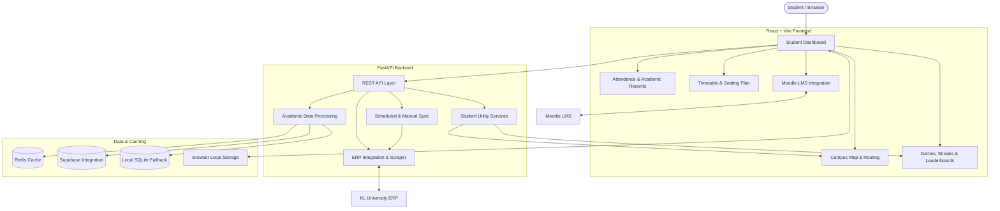

# KL Edge: Student Utility & Academic Management Platform

[](https://kl-edge.vercel.app/)
[](https://github.com/harsha08-2k6/KL-Edge)

[](https://fastapi.tiangolo.com)
[](https://react.dev)
[](https://vite.dev)
[](https://python.org)
[](https://tailwindcss.com)
[](https://redis.io)
[](https://supabase.com)
[](https://react-leaflet.js.org)
[](https://kl-edge.onrender.com)

**Live Application:** [https://kl-edge.vercel.app/](https://kl-edge.vercel.app/)  
**GitHub Repository:** [https://github.com/harsha08-2k6/KL-Edge](https://github.com/harsha08-2k6/KL-Edge)

---

**KL Edge** is a full-stack student utility and academic management platform built specifically for **K L University** students. It consolidates essential academic information, real-time attendance tracking, dynamic timetables, interactive campus navigation, examination seating plans, faculty directories, Moodle LMS integration, and student engagement tools into a single, responsive application.

Unlike traditional ERP workflows that require students to navigate multiple cumbersome pages for everyday tasks, KL Edge provides a unified, instant interface for accessing academic information and campus utilities. Its automated ERP synchronization workflow is designed to refresh supported academic data every 15 minutes, with manual on-demand synchronization always available.

---

## 🏛️ System Architecture

KL Edge uses a React-based frontend and a FastAPI backend to seamlessly connect student-facing features with university ERP data, academic processing services, caching layers, and external integrations.



*The diagram represents the principal application components. Exact service boundaries, persistence behavior, and integration flows depend on the deployed environment.*

---

## ✨ Key Capabilities

### 📊 Attendance & Academic Intelligence
- **ERP-Aligned Attendance Calculation:** Exact subject attendance calculation using configured KL University session weights: **Lecture ($L$) = 1.0**, **Tutorial ($T$) = 1.0**, **Practical ($P$) = 0.5**, and **Skilling ($S$) = 0.25**.
- **Subject-Wise Analysis:** Granular breakdown of attendance percentages, attended vs. conducted sessions, and available academic component statistics.
- **Required-Class Calculator:** Instantly estimates how many consecutive classes are needed to reach a target threshold (e.g., 75% or 85%).
- **Shortage Prediction:** Proactively identifies potential shortages and computes maximum skippable classes without dropping below mandatory criteria.
- **Academic Records:** Direct access to published internal marks, lab components, and semester results.
- **CGPA Calculator:** Dynamic calculation and tracking of semester GPAs and cumulative CGPA across semesters.

### 🔄 Automated ERP Synchronization
- **15-Minute Automatic Sync:** Background scheduled synchronization keeps attendance, schedules, and seating fresh.
- **On-Demand Manual Sync:** One-click refresh to fetch the latest academic data straight from the ERP.
- **Resilient Fallback:** Cached responses via Redis (with SQLite fallback) ensure immediate response times even when the upstream ERP server is slow or experiencing downtime.
- **Automated CAPTCHA Resolution:** Seamless OCR authentication via `ddddocr` eliminates repetitive manual login friction.

### 🗺️ Interactive Campus Map
- **Categorized Points of Interest (POIs):** Academic blocks, hostels, administrative offices, libraries, cafeterias, and student activity centers.
- **Shortest-Path Navigation:** Integrated campus route discovery with turn-by-turn guidance.
- **Ratings & Reviews:** Community-driven feedback, ratings, and student tips for campus locations.
- **Category-Based Filtering:** Search and filter nearby amenities easily.
- **Interactive UI:** Smooth geospatial rendering powered by React Leaflet.

### 📅 Timetable & Examination Seating
- **Daily Timetable & Class Schedule:** Interactive timetable organized by day and period.
- **Rich Course Mappings:** Course codes mapped to comprehensive titles, room numbers, and faculty details.
- **Examination Seating Plan:** Lookup classroom seating allocations, hall tickets, and examination halls.
- **Mobile-Optimized:** Quick schedule lookup optimized for mobile viewing between classes.

### 🎓 CGPA & Academic Performance
- **Grade Estimation:** Simulate expected grades and calculate target CGPA.
- **Semester History:** Visual progression tracking across past academic terms.
- **Performance Insights:** Identify trends across subjects and semesters to plan academic goals.

### 👨‍🏫 Faculty Directory
- **Faculty Search:** Quick search by faculty name, department, or course.
- **Cabin & Location Locator:** Pinpoints faculty cabin numbers and office locations across academic buildings.
- **Direct Contact Info:** Access available contact information and consultation hours.

### 📚 Moodle LMS Integration
- **Unified Assignment Dashboard:** Track upcoming Moodle assignments and coursework deadlines.
- **Urgency Indicators:** Color-coded status alerts for upcoming deadlines, due soon, and overdue tasks.
- **Direct Portal Links:** One-click direct navigation to assignment submission pages.

### 🎮 Mini-Games Arcade
- **Stress-Relief Games:** Classic mini-games including **Tic-Tac-Toe** and **Snake**.
- **Personal Performance Tracking:** High-score leaderboards and stats tracking to beat personal bests between study sessions.

### 🔥 Daily Streaks & Leaderboards
- **Daily Login Streaks:** Encourages daily academic tracking through interactive streaks.
- **Peer Leaderboard:** Compare streak milestones and platform engagement with peers.
- **Auto-Syncing Progress:** Streak statistics sync automatically with secure persistent storage.

### 📱 Progressive Web App & Responsive UI
- **Cross-Platform PWA:** Installable on Android, iOS, Windows, macOS, and Linux.
- **Modern Design:** Built with Tailwind CSS, sleek dark mode aesthetics, and micro-animations.
- **100% Lighthouse Accessibility:** Strict high-contrast compliance and accessible typography.

### ⚡ Performance & Data Handling
- **Ultra-Fast Builds:** Powered by Vite 5 and React 19.
- **High-Throughput Backend:** Asynchronous FastAPI server running on Python 3.10+.
- **Multi-Tiered Caching:** Redis cache with automatic SQLite fallback for high availability.
- **Client-Side Persistence:** Local storage ensures rapid page transitions and offline capability.

---

## 🛠️ Technology Stack

| Layer | Technologies | Purpose |
|---|---|---|
| **Frontend Framework** | React 19, JSX | Component-based, responsive user interface |
| **Build Tool & Bundler** | Vite 5 | Fast development server and optimized production bundles |
| **Styling & Design** | Tailwind CSS, Lucide Icons, Motion | Modern UI tokens, responsive layouts, and smooth animations |
| **Campus Maps** | React Leaflet, Leaflet.js | Interactive campus map, POI markers, and route navigation |
| **Backend Framework** | FastAPI, Python 3.10+ | Asynchronous REST APIs, session management, and routing |
| **ERP Integration** | BeautifulSoup4, HTTPX, Requests | University ERP session handling, HTML parsing, and data extraction |
| **CAPTCHA Processing** | ddddocr, Pillow | Automated OCR CAPTCHA recognition for seamless authentication |
| **Caching Layer** | Redis, SQLite | High-speed caching for timetable, attendance, and session tokens |
| **Data Integration** | Supabase | Cloud persistence for engagement metrics, streaks, and feedback |
| **Client Persistence** | Browser Local Storage | Client-side session and offline preferences |
| **Containerization** | Docker | Containerized backend deployment environment |
| **Frontend Hosting** | Vercel | Global CDN deployment and live frontend hosting |
| **Backend Hosting** | Render / Cloud Hosting | Containerized FastAPI backend deployment |
| **Version Control** | Git, GitHub | Distributed version control and CI/CD collaboration |

---

## 📂 Repository Structure

```text
KL-Edge/
├── backend/
│   ├── routes/
│   │   └── map.py               # Campus map API routes & POI management
│   ├── services/
│   │   ├── lms_scraper.py       # Moodle LMS integration & assignment fetcher
│   │   ├── map_chat.py          # Campus assistant conversational service
│   │   ├── map_db.py            # SQLite database service for campus locations
│   │   └── map_routing.py       # Shortest path navigation & Dijkstra routing
│   ├── campus_map.db            # SQLite database for campus locations & routes
│   ├── Dockerfile               # Production container configuration for backend
│   ├── erp_scraper.py           # Core ERP session handling, scraper & calculations
│   ├── faculty.json             # Faculty database with cabin locations & details
│   ├── main.py                  # FastAPI application entry point, middleware & API routes
│   ├── package.json             # Backend workspace scripts
│   ├── requirements.txt         # Python dependencies
│   ├── supabase_client.py       # Supabase client integration
│   └── .env.example             # Template for backend environment variables
│
├── frontend/
│   ├── components/              # Modular UI components (Timetable, Nav, Cards, CustomCursor)
│   ├── pages/                   # Application pages
│   │   ├── games/               # Mini-games (Snake, Tic-Tac-Toe, Arcade Hub)
│   │   ├── assignments.jsx      # Moodle assignments dashboard
│   │   ├── cgpa.jsx             # CGPA & semester GPA calculator
│   │   ├── faculty.jsx          # Faculty directory & cabin locator
│   │   ├── index.jsx            # Student dashboard & live overview
│   │   ├── map.jsx              # Campus map & navigation page
│   │   ├── seating-plan.jsx     # Examination & classroom seating lookup
│   │   ├── streak.jsx           # Daily streak tracker & leaderboard
│   │   └── timetable.jsx        # Weekly class timetable & mappings
│   ├── public/                  # Static assets, icons, manifest.json
│   ├── styles/                  # Tailwind styles and custom CSS definitions
│   ├── utils/                   # Client utilities (api.js, attendance.js, timetable.js)
│   ├── App.jsx                  # Main application routing and state shell
│   ├── main.jsx                 # Frontend entry point
│   ├── package.json             # Frontend dependencies and build scripts
│   ├── tailwind.config.js       # Tailwind CSS theme configuration
│   └── vite.config.js           # Vite build and PWA configuration
│
├── vercel.json                  # Frontend deployment & API reverse-proxy configuration
├── package.json                 # Monorepo root scripts (runs frontend & backend together)
└── README.md                    # Project documentation
```

---

## 🚀 Quick Start Guide

### Prerequisites

Ensure you have the following installed on your machine:
- **Python 3.10+**
- **Node.js 18+** & **npm**
- **Git**
- *(Optional)* **Redis** server (falls back to local SQLite if unavailable)
- *(Optional)* **Docker**

---

### Option A: Monorepo Single Command (Recommended)

From the project root:

```bash
# 1. Clone repository
git clone https://github.com/harsha08-2k6/KL-Edge.git
cd KL-Edge

# 2. Install dependencies for all workspaces
npm install

# 3. Setup backend environment
cd backend
python -m venv .venv

# Windows:
.\.venv\Scripts\Activate.ps1
# macOS/Linux:
# source .venv/bin/activate

pip install -r requirements.txt
cp .env.example .env

# 4. Return to root and launch both Frontend & Backend
cd ..
npm run dev
```

---

### Option B: Separate Backend & Frontend Setup

#### 1. Backend Setup

```bash
cd backend

# Create virtual environment
python -m venv .venv

# Activate virtual environment
# Windows PowerShell:
.\.venv\Scripts\Activate.ps1
# macOS / Linux:
source .venv/bin/activate

# Install dependencies
pip install -r requirements.txt

# Create .env from template
cp .env.example .env
```

Edit `backend/.env` with your configuration:
```ini
PORT=8000
FRONTEND_ORIGIN=http://localhost:5173
REDIS_URL=redis://localhost:6379
SUPABASE_URL=your_supabase_url
SUPABASE_KEY=your_supabase_key
ERP_LOGIN_URL=https://newerp.kluniversity.in/index.php
LMS_URL=https://lms.kluniversity.in
```

Start the FastAPI development server:
```bash
uvicorn main:app --reload --port 8000
```
- **Backend API:** `http://127.0.0.1:8000`
- **Swagger Documentation:** `http://127.0.0.1:8000/docs`
- **ReDoc Documentation:** `http://127.0.0.1:8000/redoc`

#### 2. Frontend Setup

In a new terminal window:
```bash
cd frontend

# Install dependencies
npm install

# Start Vite development server
npm run dev
```

Open your browser at `http://localhost:5173`.

---

### Option C: Running Backend with Docker

A production-ready [backend/Dockerfile](file:///d:/KL-Edge/backend/Dockerfile) is provided for containerized environments:

```bash
cd backend

# Build Docker image
docker build -t kl-edge-backend .

# Run Docker container
docker run -d -p 8000:8000 --env-file .env --name kl-edge-api kl-edge-backend
```

---

## 🧪 Testing & Verification

KL Edge should be verified across its academic, integration, and student utility features before production deployment:

### Backend Verification
- **API Health & Docs:** Visit `http://127.0.0.1:8000/docs` and test endpoints.
- **ERP Authentication:** Test authentication and CAPTCHA solving with an authorized student account.
- **Attendance Weighting:** Verify that session weights match standard KL University weighting:
  $$\text{Attendance} = \frac{L \times 1.0 + T \times 1.0 + P \times 0.5 + S \times 0.25}{\text{Total Conducted Weighted Sessions}} \times 100$$
- **Timetable & Seating Retrieval:** Confirm schedule and examination room lookup.
- **Caching Mechanism:** Check that repeated requests serve from Redis or SQLite cache within milliseconds.

### Frontend Production Build
```bash
cd frontend
npm run build
```
Verify that the production build completes with zero errors and outputs assets to `frontend/dist/`.

### Integration Verification
- Verify that `frontend/dist` connects smoothly to the backend API.
- Confirm that CORS allows requests from the frontend origin.
- Check that the PWA service worker installs cleanly and allows offline caching of static assets.

---

## 📡 Core Functional Modules

| Module | Primary Responsibility |
|---|---|
| **ERP Integration** | Authenticates, solves CAPTCHA via `ddddocr`, and extracts real-time ERP data |
| **Attendance Tracker** | Computes ERP-weighted attendance, safe skips, and required classes |
| **Academic Records** | Aggregates internal marks, lab components, and semester grades |
| **Timetable Matrix** | Organizes daily schedules, mapped courses, timings, and rooms |
| **Seating Plan** | Provides examination seating, classroom numbers, and bench indices |
| **CGPA Engine** | Calculates semester GPAs, cumulative CGPAs, and targets |
| **Campus Map & Routing** | Renders Leaflet campus layout, POIs, and shortest-path routing |
| **Faculty Locator** | Provides searchable faculty directory with cabin designations |
| **Moodle LMS Sync** | Surfaces coursework deadlines, submission portals, and urgency badges |
| **Streaks & Leaderboard** | Tracks consistent logins and displays student engagement rankings |
| **Mini-Games Arcade** | Lightweight browser games for study breaks |
| **Sync Manager** | Orchestrates 15-minute background synchronization & manual sync |

---

## 🌐 Live Deployment

KL Edge is deployed and active in production:

- **Frontend Deployment (Vercel):** [https://kl-edge.vercel.app/](https://kl-edge.vercel.app/)
- **Backend Deployment (Render):** [https://kl-edge.onrender.com](https://kl-edge.onrender.com)
- **Source Repository:** [https://github.com/harsha08-2k6/KL-Edge](https://github.com/harsha08-2k6/KL-Edge)

### Frontend Deployment (Vercel)
The root `vercel.json` automatically handles routing and proxies `/api/*` requests to the Render backend:
```bash
cd frontend
npm run build
```
Deploy the output via the Vercel dashboard or CLI.

### Backend Deployment (Render / Cloud)
Deploy the FastAPI application using the included [backend/Dockerfile](file:///d:/KL-Edge/backend/Dockerfile) or Python web service:
```bash
uvicorn main:app --host 0.0.0.0 --port 8000
```

### Production Checklist
- [x] Configure `FRONTEND_ORIGIN` and strict CORS policies.
- [x] Ensure secure environment variables (`REDIS_URL`, `SUPABASE_URL`, `SUPABASE_KEY`).
- [x] Validate scheduled 15-minute sync background workers.
- [x] Verify SSL/TLS certificates (HTTPS) across both frontend and backend.
- [x] Enable error telemetry and log monitoring.

---

## 🔐 Security & Privacy

KL Edge is engineered with student privacy as a foundational requirement:

- **Client-Side Credential Storage:** Student credentials remain on the student's personal device in secure browser storage and are never persisted to external database servers.
- **Stateless ERP Authentication:** Sessions authenticate directly through the backend integration pipeline to fetch requested records.
- **Zero Logging of Sensitive Secrets:** Student passwords, authorization tokens, and personal identifiers are excluded from logs.
- **Encrypted Transmission:** All communications between the client, backend, ERP, and LMS use encrypted HTTPS channels.
- **Configurable Access Controls:** Production environments enforce strict CORS origins and sanitized error messages.

---

## 🎯 Project Objectives

- **Eliminate ERP Complexity:** Replace sluggish and fragmented legacy ERP pages with a fast, modern single-page dashboard.
- **Empower Academic Decision Making:** Give students immediate foresight into attendance safety, shortages, and required classes.
- **Centralize Campus Utilities:** Integrate schedules, campus maps, faculty cabins, and assignments under one roof.
- **Mobile-First Experience:** Deliver a fast, responsive Progressive Web App that works seamlessly on any device.
- **Encourage Consistency:** Foster healthy daily academic habits through streak tracking and engagement tools.

---

## 🔮 Future Improvements

- [ ] **AI Attendance Insights:** Predictive modeling for optimal attendance planning based on historical class schedules.
- [ ] **Automated Exam Timetable Reminders:** Browser push notifications for upcoming exams and assignment submission deadlines.
- [ ] **Peer Resource Sharing:** Student notes, study guides, and previous question papers library.
- [ ] **Enhanced Offline Support:** Full offline caching of timetables and attendance for low-connectivity campus spots.
- [ ] **Crowdsourced Campus Updates:** Live student updates on cafeteria wait times, library seat occupancy, and campus shuttle tracking.

---

## 🤝 Contributing

Contributions, bug reports, and feature suggestions are warmly welcomed!

1. Fork the repository: `https://github.com/harsha08-2k6/KL-Edge`
2. Create a feature branch: `git checkout -b feature/amazing-feature`
3. Commit your changes: `git commit -m "feat: add amazing feature"`
4. Push to branch: `git push origin feature/amazing-feature`
5. Open a Pull Request describing your improvements.

For major architectural proposals, please open an Issue first to discuss what you'd like to change.

---

## 📄 License

This project is licensed under the **MIT License** - see the `LICENSE` file for details. Built for educational and productivity purposes for the students of K L University.

---

## ⭐ Support & Acknowledgements

If KL Edge makes your campus life or academic management easier, please give the repository a **Star** on GitHub!

- **Live Application:** [https://kl-edge.vercel.app/](https://kl-edge.vercel.app/)
- **GitHub Repository:** [https://github.com/harsha08-2k6/KL-Edge](https://github.com/harsha08-2k6/KL-Edge)
